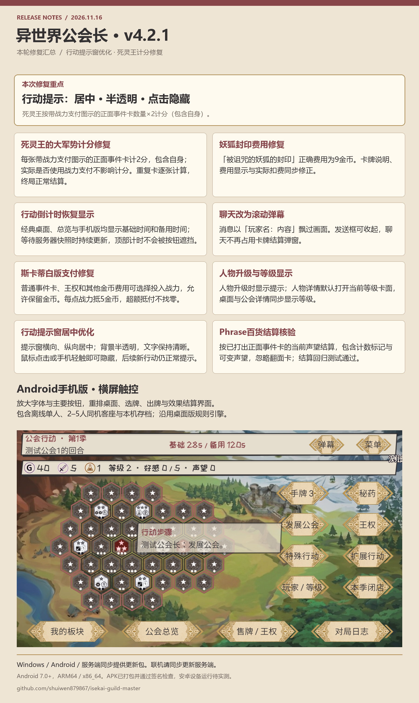

# 异世界公会长 4.2.1

基于台湾友人 [cat90132-beep 的 refactor v4.0 发布版](https://github.com/cat90132-beep/isekai-guild-master/releases/tag/refactor)继续更新，保留扫描卡面、繁简切换、同机客座、交接确认、本机存读档、扩充规则与操作改进。上游完整说明见 [UPSTREAM_README](docs/UPSTREAM_README.md)。

本次构建位于 `dist/`：Windows 解压 `GuildMaster-Windows-4.2.1.zip` 后运行 `GuildMaster.exe`；Android 安装 `GuildMaster-Android-4.2.1.apk`。Android 需要 Android 7.0 以上、64 位 ARM 或 x86_64，横屏使用，已内嵌离线 Python 规则引擎，无需另外安装运行库。



## 本次修改

- 4.2.1：行动步骤窗口移到画面正中央，背景半透明，点击或轻触可隐藏。
- 修复死灵王的大军势（A-029）的终局计分：每张带战力支付图示的正面事件卡得2分，包含自身，与实付战力无关；重复卡逐张计入。修正打出时秘药收益，多人本人合计3瓶、其他玩家各1瓶；单人按原规则不结算全体收益。

- 修复「被诅咒的妖狐的封印」（卡牌99）费用误写为18的问题：正确费用为9金币，卡牌说明、界面显示与实际支付同步修正。
- 修复经典桌面、总览和手机版行动倒计时显示；基础时间与备用时间分别显示，等待服务器快照时也持续更新。
- 聊天改为“玩家名：消息”滚动弹幕，发送框可收起，不占用卡牌结算弹窗。
- 人物升级与多人公开行动步骤加入自动消失的提示窗；人物详情默认打开当前等级，桌面显示等级。
- 丝卡迪白版可以在普通事件卡、王权、情报收集和发展等金币费用中选择投入战力，允许保留金币；每点战力抵五金币，超额不找零。联机需同步更新本次服务器包。
- 验证 Phrase 百货按已打出正面事件卡的当前声望结算，包含计数标记和可变声望，忽略翻面卡，不递归计算自身。
- 新增手机触控桌面、选牌、出牌与效果结算布局，放大字体与主要按钮。离线单人、同机客座和本机存档沿用桌面版规则与存档逻辑。

- 4.1.1：普通联机未收到服务器确认时自动重试备用通道；默认地址和端口仍为 `guanpeng666.cn:6677`。配音新安装默认关闭，旧配置一次性迁移为关闭，之后手动开启会保存。
- 为之前裁切卡面的希芙、芙莉达、贝露、霍伦、玛尔塔制作10张独立立绘，覆盖11个规则版本，并保留黑白版本不同外观；其余角色沿用现有立绘。

- 提取截图中的34张卡面，接入希芙、芙莉达、贝露、霍伦、玛尔塔的11套能力版本和专属事件“懒散生活”；不同能力保留为不同选项，原版角色仍可选择。
- 蓓尔白版按**印刷费用个位数0或5**触发，覆盖10、15、20等费用，不使用折扣后的实付金币。
- 按日文《拡張ルールブック》第17页，单人选择艾露背面时改用**皮耶利亚背面**，包括初始资产、常驻能力与升级；选角显示替换说明。
- 全部25个人物名称、57个可选版本均有中日双语配音，两种语言各567段，共1134段。**配音默认关闭，开启后默认日语**，设置中可切换中文、关闭配音、调节独立音量并选择人物试听；切换语言或关闭时立即停止当前语音与待播队列。
- 日语优先使用本次提供的13组、284份录音，按台本与文件槽位匹配；白的红面R1、R2未提供，继续使用已有配音。其他未覆盖角色和全部中文配音逐文件保留。紫苑22段与先前样例相同，未重复转换。完整映射及缺失保留清单见 `docs/SUPPLIED_VOICE_OVERRIDES.json`。语音全部随包离线播放，界面仍默认简体中文。
- 新安装默认简体中文，保留繁体切换。设置可选择经典或总览两种桌面布局，沿用原配色。
- 补齐启动场景、完整离线运行库及外部素材路径；客户端、服务器与回放资源同步更新。

## 所有 DLC 与扩充玩法


## 联机与部署

默认游戏服务器 `guanpeng666.cn:6677`；回放为 `http://guanpeng666.cn:6767`，介绍与更新长图在 `http://guanpeng666.cn:6680`。4.2客户端与服务端需一起更新。只更新源码不会改变已经运行的服务。

服务器使用 `dist/guild-server-4.2.1.zip`，或直接使用仓库 `guild-server/`。仅需 Python 3.9以上及标准库；保留自己的 `server_config.json`、`replays/`，在没有进行中对局时停止旧服务，替换程序及网页后重启：

```sh
python3 server.py --host 0.0.0.0 --port 6677 --web-port 6767 --site-port 6680
```

## 从源代码运行

客户端源码在 `GuildMaster-Godot-src/`，使用 Godot 4.7.2。将 `GuildMaster-Godot/` 下 `art/`、`rules/`、`runtime/` 复制至源码目录，可按 F5 运行。规则源文件以 `guild-server/` 为准，`python tools/prepare_update.py` 同步到离线客户端。

构建：`python tools/build_update_release.py`，输出在 `dist/`。可通过 `GODOT_BIN` 指定Godot控制台程序；导出模板在Godot中安装或填写 `export_presets.cfg`。GitHub源码不包含exe与Python标准库zip，首次构建需从完整客户端包复制 `runtime/`，或使用官方Python 3.13嵌入式运行库。

Android：先执行 `python tools/prepare_android_sdk.py`，再执行 `python tools/build_android.py`。构建使用 Godot Android 模板、JDK 21 和 Chaquopy 17.2 / Python 3.13；`ANDROID_SDK_ROOT`、`GODOT_BIN` 与 `GUILD_ANDROID_BUILD` 可覆盖本机路径。APK 包含 ARM64 与 x86_64；当前为本地签名安装包，未发布到应用商店。`--verify-mobile` 启动参数可自动检查离线单人、三人客座、选角、情报收集、倒计时与存档，并写入 `user://mobile-check.json`。

验证：`python -m unittest discover -s tests -v`。`GuildMaster-Godot-src/tools/update_qa.gd` 检查新卡面、配音开关、默认语言与2/5人布局。上游规则回归脚本保留在 `GuildMaster-Godot/tools/`。

## 来源与许可

台湾友人的改动保留署名与原始说明。新卡面及配音由用户提供，原始ZIP与截图不被修改；提取坐标与校验值见 `docs/SUPPLIED_ASSETS.json`。日文规则书用于核对，未重复加入发行包。游戏美术、字体、Godot和Python的许可见包内 `LICENSES/` 与 `runtime/LICENSE.txt`。
